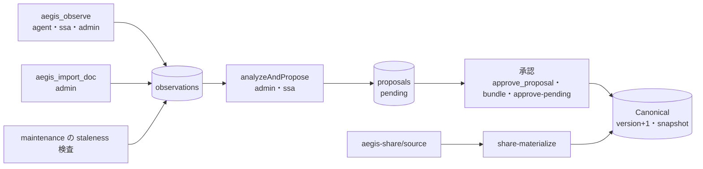
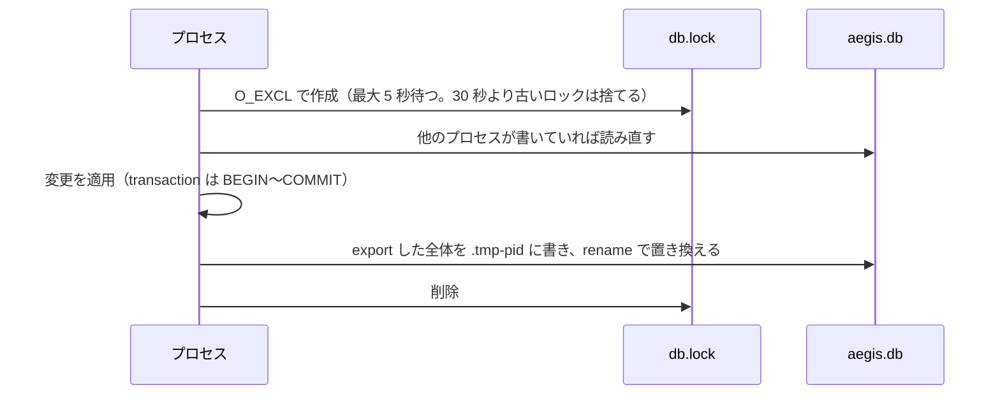

# aegis 設計

## 概要（簡潔に）

- aegis は決定的なコンテキストのコンパイラである。読み取り経路（`aegis_compile_context`）は承認済みの DAG だけを決まった順でたどり、推論を挟まない。知識の変更は「Observation（観測）→ Proposal（提案）→ 人の承認 → Canonical（正本）」の 1 本の経路だけを通る。
- 権限はサーフェスで分ける。agent サーフェスは読むことと Observation を記録することしかできず、Canonical を変える操作は admin サーフェスと CLI にあり、ssa サーフェスは提案の 1 件ずつの承認（`aegis_approve_proposal`）だけを持つ。境界はツールの登録とサービス層の検査の 2 か所で守る。
- DB は sql.js（WASM の SQLite）で、各プロセスが DB の全体をメモリに持つ。複数のプロセス（agent・admin・CLI）が同じファイルを使うので、書き込みは必ず「ロック → ディスクから読み直し → 変更 → 一時ファイルに書いて rename → ロック解除」の順で行う。
- このフォークは ADR-019 で運用を軽くした。staleness の検査対象を `git ls-files` に絞り、一括承認と staleness の確定を CLI 専用で足し、snapshot を刈り込み、未導入のプロジェクトで DB を作らないようにした。
- 外から観測できる振る舞い（引数・既定値・終了コード）は `docs/spec.md` に置く。本書は内部の構造と、元に戻してはいけない判断の理由を書く。

## モジュール構成

`src/core/` は `src/mcp/`・`src/adapters/`・`src/expansion/` を import しない。外側の層が core を使う一方向の依存である。

| パス | 役割 |
|---|---|
| `src/main.ts` | 入口。起動引数の解析、CLI のサブコマンドの振り分け、DB の選択（未導入の判定）、MCP サーバーの起動 |
| `src/mcp/server.ts` | MCP のツールとリソースの登録。サーフェスが `ssa`・`admin` のときに ssa の 7 ツールを、`admin` のときだけ残りの管理用の 11 ツールを登録する |
| `src/mcp/services.ts` | サービスの窓口（`AegisService`）。管理用の操作は先頭で `assertSurfaceAllows` を呼ぶ（判定は `isOperationAllowedOnSurface`、ssa の許可リストは `SSA_ALLOWED_OPERATIONS`）。Observation の検証、分析器の登録表、`maintenance`、アダプタの配布もここ |
| `src/mcp/tool-error.ts` | ツールのエラー応答に原因を必ず含める補助 |
| `src/core/read/` | `compiler.ts`（DAG のたどり方・notices）、`allocator.ts`（delivery の割り当て）、`workspace-status.ts` |
| `src/core/store/` | `database.ts`（sql.js の包装・ロック・永続化）、`repository.ts`（Canonical の読み書き・承認・snapshot）、`schema.ts`、`migrations/`（001〜016）、`snapshot-pruning.ts` |
| `src/core/automation/` | Observation の分析器、提案の作成（`propose.ts`）、一括承認（`approve-pending.ts`） |
| `src/core/optimization/` | staleness の検査（`staleness.ts`）、ファイルの列挙（`repo-file-listing.ts`）、staleness の確定（`staleness-ack.ts`）、取り込み計画、エッジ候補、文書分割の判定、co-change のキャッシュ |
| `src/core/init/` | スタックの検出、テンプレートの読み込み、初期化、テンプレートの更新 |
| `src/core/project-share/` | 共有バンドルの書き出しと DB の作り直し、共有ソースの検査・整形・適用・書き出し、共有の状態の判定 |
| `src/core/tagging/` | 意図タグの推定の口（`IntentTagger`） |
| `src/adapters/` | `CLAUDE.md`・`AGENTS.md`・`.cursor/rules/` の管理ブロックとスキルの配布 |
| `src/expansion/` | 内蔵の llama.cpp と Ollama による `IntentTagger` の実装、モデルの一覧 |

## 不変条件と強制箇所

原則（P-1〜P-5）と不変条件（INV-1〜INV-6）の原文は `docs/プロジェクト計画v2.md` にある。現行のコードでの意味と強制箇所は次のとおりである。

| 条件 | 現行の内容 | 強制箇所 |
|---|---|---|
| P-1 決定性 | 同じ入力と同じ `knowledge_version` なら `base` と `warnings` は同じになる | `compiler.ts` の並べ替え（具体性・優先度・ID）、`allocator.ts` の採用順、時刻や運用状態に依存する情報を `notices` に分けること。`expanded` は SLM を使うと最善努力になるが、`intent_tags` を渡せば決定的になる |
| P-3 人の承認 | Canonical の変更は承認を経る | `propose.ts` は提案を常に `pending` で作る。変更を適用するのは `Repository` の承認処理だけである。例外は「P-3 の例外として残す経路」の節 |
| INV-1 承認済みだけを読む | 読み取り経路は `approved` の文書とエッジだけを見る | `Repository` の承認済みの取得関数 |
| INV-2 DAG | 承認済みの `doc_depends_on` は循環しない | 承認時の `wouldCreateCycle` の検査 |
| INV-3 snapshot の不変性（緩和済み） | 残した世代の行は変えない。保持外の世代の内容行は刈り込みうる（ADR-019 D-4） | `snapshot-pruning.ts` |
| INV-4 版の単調増加 | 承認ごとに `knowledge_version` を 1 増やし、snapshot を作る | `_approveProposalInTransaction` |
| INV-5 監査 | compile の結果は `compile_id` と `snapshot_id` を持ち、`compile_miss` は両方を参照する | `compiler.ts`、`validateObserveEvent` |
| INV-6 権限分離 | agent サーフェスから Canonical を変えられない | `server.ts` の `if (surface === 'ssa' \|\| surface === 'admin')`（ssa の 7 ツール）と `if (surface === 'admin')`（admin だけの 11 ツール）による登録の分岐と、`services.ts` の `assertSurfaceAllows`（許可リスト `SSA_ALLOWED_OPERATIONS`、拒否は `SurfaceViolationError`）の 2 か所 |

- INV-6 の原文は「Canonical を変えられるのは `approve_proposal` と `init_confirm` だけ」と書くが、現行ではバンドルの承認、`approve-pending`、`share-materialize`、`share-hydrate` も Canonical を変える。いずれも admin サーフェスか CLI にあり、agent・ssa サーフェスには無い。ssa から Canonical を変える経路は `aegis_approve_proposal`（1 件ずつ）だけである（ADR-020）。
- agent の操作（`compileContext`・`observe` など）はサーフェスを検査しない。agent の操作が書くのは `compile_log` と `observations` だけで、Canonical に触れないからである。

## Observation から Canonical までの流れ

1. `aegis_observe` は Observation を 1 行書くだけで、分析も提案もしない（ADR-003 D-1）。
2. 分析は admin の明示操作（`aegis_process_observations`・`aegis_import_doc`・`maintenance`）だけが行う。`analyzeAndPropose` はトランザクションの中で対象の `analyzed_at` を先に埋めて取り分け、分析に失敗したら取り分けを戻す。
3. 分析器は種別ごとの固定の登録表で選ぶ。`compile_miss` は `CoverageAnalyzer`（中で `RuleBasedAnalyzer` と文書分割の判定を使う）、`review_correction`・`pr_merged`・`manual_note`・`document_import` はそれぞれ専用の分析器である。`doc_gap_detected` と `staleness_detected` の分析器は提案を作らない。
4. `ProposeService` は提案を `pending` で作り、pending の提案全体に対して意味のキーで重複を除き、提案と根拠の対応を 1 トランザクションで書く。
5. 承認（`_approveProposalInTransaction`）は、pending でない提案とバンドルに属する提案（単独の承認のとき）を拒否し、修正を当て、`source_path` を正規化し、変更を適用し、状態を `approved` にし、`knowledge_version` を 1 増やし、snapshot を作る。ここまでを 1 トランザクションで行う。
6. 却下は根拠の Observation の `analyzed_at` を戻して再分析できるようにする。`approve-pending` の却下（`superseded`・`stale_content`）だけは戻さない。戻すと同じ提案がまた作られるからである。

### P-3 の例外として残す経路

- `bootstrap` の提案は根拠の Observation を持たない。初期化は Observation から始まる流れではないためである（ADR-006）。
- テンプレートの更新（`aegis_apply_upgrade`）も Observation なしで提案を作る。承認は人が行う（ADR-006 D-6）。
- `share-materialize` は共有ソースとの差を `materialize` の提案として記録し、同じトランザクションで承認する。共有ソースの PR のマージを承認とみなす経路で、共有ソースにだけ使う（ADR-018 D-2・D-6）。

## DB 層の書き込み経路

`src/core/store/database.ts` は sql.js の DB を包む。sql.js はファイルのロックを持たず、各プロセスは DB の全体をメモリに持ち、書き込みのたびに全体をファイルへ書き出す。

- 1 文の書き込み（`run`・`exec`）は、トランザクションの外ならロックを取り、ファイルの mtime が手元より新しければ読み直してから実行する。
- `transaction` はロックを取り、無条件に読み直してから `BEGIN` し、成功すれば `COMMIT` して書き出し、失敗すれば `ROLLBACK` する。
- 読み取りはロックを取らず、mtime が変わっていれば読み直す。
- 書き出しは一時ファイルに書いてから rename で置き換え、記録する mtime は一時ファイルのものを使う。
- `createDatabase` はロックを取ってから読み、スキーマの作成・移行・`knowledge_meta` の初期行の用意をロックの下で行う。ファイルを書くのは、新規か、スキーマか移行で変化があったときだけである。0 バイトの既存ファイルは 1 度だけ読み直し、それでも空なら開かない。
- 元に戻さないこと: ロックと読み直しを省いて書く経路を作らない。全体を書き出す方式なので、読み直さずに書くと他のプロセスの変更を消す。直接の上書き（rename を使わない書き込み）にも戻さない。書き込みの途中で落ちると DB が壊れる。開くだけで書き出す形にも戻さない。最新の DB を開くたびにファイルが書き換わり、他のプロセスに読み直しを強いる。

## snapshot の保持と圧縮

- 判断: `createSnapshot` の最後で `pruneSnapshots` を呼び、`knowledge_version` の新しい順に保持数（既定 20、`AEGIS_SNAPSHOT_RETENTION`）の世代と、`compile_log`・`observations`・`init_manifest` から参照される世代を残す。それ以外の世代は内容行（`snapshot_docs`・`snapshot_edges`・`snapshot_layer_rules`）だけを消し、見出しの行は残す。刈り込みの失敗はログに出すだけで、承認を失敗させない。`VACUUM` は `maintenance` の最後に、トランザクションの外で、空き領域が 1 MiB 以上かつファイルの 25% 以上のときだけ実行する（ADR-019 D-4）。
- 理由: snapshot の内容行は承認のたびに増え、DB ファイルが肥大する。内容行は `src` のどこからも読まれず、compile の監査は `compile_log` の記録に依存するので、刈り込んでも再現性と監査は保持側の世代で守られる。見出しの行を残すのは、外部キーの参照と `knowledge_version` と `snapshot_id` の対応を保つためである。`DELETE` だけでは sql.js の `export()` の大きさは縮まないので `VACUUM` が要る。閾値は経験的な推測で、変えるときは定数だけを変える。
- 元に戻さないこと: 見出しの行を消さない。外部キーを外さない。刈り込みのたびの `VACUUM` や `PRAGMA auto_vacuum` にしない。INV-3 を「INSERT ONLY」の原文に戻して刈り込みを外さない。

## staleness の Level 1〜3 と基準値

`maintenance` の中で `collectSemanticStalenessFindings` が承認済みの文書を検査し、指摘を `staleness_detected` の Observation として記録する。同じ内容のアーカイブされていない Observation があれば記録しない。指摘には版 `SEMANTIC_STALENESS_ALGORITHM_VERSION`（現在 `015-10-3`）を付ける。

| Level | 種別 | 検査の内容 |
|---|---|---|
| 1 | `hash_mismatch` | `file-anchored` で `source_path` を持つ文書について、ソースファイルの SHA-256 が DB の `content_hash` と違う。`source_refs` が 2 つ以上の文書は対象外 |
| 2 | `source_unreadable`・`source_missing`・`rename_candidate` | ソースファイルを読めない・無い。無いときは同じ内容のファイルを探して改名の候補として出す |
| 3 | `linked_file_added`・`linked_file_removed`・`symbol_drift` | 文書に結び付くファイルの指紋を基準値と比べる。結び付くファイルは、承認済みの `path_requires`（パスを起点とするもの）の glob に一致する列挙済みのファイルと、`source_refs` が 2 つ以上なら参照先のパスである |

- 指紋は、TypeScript 系（`.ts`・`.tsx`・`.mts`・`.cts`）なら export したシンボル名の一覧の SHA-256、それ以外ならファイルのバイト列の SHA-256 である。指紋は 1 回の検査の中だけでメモ化し、検査をまたいで持たない（ADR-019 D-2）。
- 基準値は `staleness_baselines`（`doc_id` ごとの指紋の JSON）に置く。基準値が無い・壊れていれば今回の指紋をそのまま基準値にして指摘を出さない。基準値を書き直すのはドリフトの無い回だけで、`--dry-run` では書かない。
- 列挙の範囲外になったパス（git の ignore の対象・飛ばすディレクトリの中）と、列挙から外れたがディスクにあってエッジの glob にまだ一致するパスは、消えても `linked_file_removed` にしない。走査から `git ls-files` に切り替えた時点の古い基準値で、指摘が永久に残らないようにするためである。
- 承認でその文書のパス起点の `path_requires` のエッジが変わる（`add_edge`・`retarget_edge` の新旧両方の文書・`remove_edge`）と、`_invalidateStalenessBaselinesForPathEdge` が同じトランザクションで基準値を消し、Level 3 の Observation をアーカイブする。
- 元に戻さないこと: 基準値をドリフトのある回に書き直さない。書き直すと、人が確かめる前に指摘が消える。エッジの変更時の基準値の削除と Observation のアーカイブを片方だけにしない。基準値を消しても Observation が残れば、同じ内容の重複除去によって、その後の指摘が記録されなくなる。

## approve-pending と staleness-ack の設計

- 判断: 一括承認（`approve-pending`）は CLI 専用にし、MCP のツールにしない。`AegisService.approvePending` も `assertSurfaceAllows` を通す（ssa・agent では `SurfaceViolationError`）。種別の順（`bootstrap → new_doc → update_doc → add_edge → retarget_edge → remove_edge → deprecate → materialize`）に 1 件ずつ `repo.approveProposal` を呼び、1 件ごとに 1 トランザクションと 1 snapshot を作る。失敗は `process.exitCode = 1` で返し、`process.exit()` は呼ばない（ADR-019 D-3）。
- 理由: AI エージェントが承認のために MCP を呼ぶ回数を 0 にしつつ、承認を人の手元の操作に保つためである。部分成功を残す要件があるので、全体を 1 トランザクションにはしない。`process.exit()` はパイプに流した stdout の JSON を途中で切る。
- 同じ文書への `update_doc` は最新だけを候補にし、ソースファイルの全体と本文が違えば `stale_content` で却下する。`document_import` から作った `update_doc` は観測した時点の本文を持つので、古い観測からの提案を順に承認すると、文書が現在のファイルより古い本文に戻る（2026-11-01 に実際に起きた）。却下では根拠の Observation を再分析の対象に戻さない。戻すと次の `maintenance` が同じ古い提案を作り直す。
- 判断: コードだけが変わったことによる Level 3 の指摘は、エッジを変えても消えない。人が文書とコードを照らして確かめた後に、admin 専用の CLI `staleness-ack` で確定する。確定は 2 段で行う。まず現在の Level 3 の指摘を数え、次に基準値なしとして取り直す。基準値の書き込みと Level 3 の Observation のアーカイブは 1 トランザクションで行う（ADR-019 D-1）。
- 理由: `maintenance` はドリフトの無い回にしか基準値を書き直さないので、確定の操作が無いと指摘が永久に残る。Observation もアーカイブしないと、重複除去によって同じ指摘が二度と記録されない。
- 元に戻さないこと: どちらも MCP のツールにしない。`aegis_approve_proposal` に配列の引数を足す形でも一括承認を MCP に出さない。バンドルに属する提案は一括承認に混ぜず、全部か無しかの `aegis_approve_proposal_bundle` に任せる。

## 未導入プロジェクトで DB を作らない判断

- 判断: MCP サーバーは、`--db` が無く `<project-root>/.aegis/` も無いとき、ディレクトリもファイルも作らず空のインメモリ DB（`createInMemoryDatabase`）で起動する。stderr に 1 行、`aegis_compile_context` の `notices` の先頭に `NOT_INSTALLED_NOTICE` を出す。導入は `.aegis/` を作って再起動することである。CLI のサブコマンドの振る舞いは変えない（ADR-019 追記）。
- 理由: プラグインとして登録した MCP サーバーはどのカレントディレクトリでも起動する。以前は起動時に `.aegis/aegis.db` を無条件に作っていたため、aegis を使わないプロジェクトにも空の DB ができていた。
- 元に戻さないこと: 起動時に無条件で `.aegis/` を作らない。
- 採らなかった案: 最初の書き込みまで DB の作成を遅らせる。接続の差し替えと書き込み経路ごとの分岐が要り、実装が複雑になる。

## 元に戻さない設計判断（ADR 別）

各 ADR の「ステータス」行は実装の有無と一致しない。011〜018 は `Proposed` のままだが、本節に挙げた範囲はコードに実装されている。ADR の記述とコードが食い違う箇所は、コードに従って書いた。

| ADR | 元に戻さない判断 |
|---|---|
| 001 | ADR-002 で置き換え済み。`manual_note` に取り込みを一本化する方針には戻さない |
| 002 | 取り込みは専用の `document_import` の Observation と admin 専用の `aegis_import_doc` で行い、Canonical を直接変えない。サーバー側の一括取り込みツール（`aegis_import_batch`）は作らない。`kind`・`doc_id`・タグの推定は呼び出し側が行い、aegis は検証だけを行う |
| 003 | `aegis_observe` は記録だけを行う。分析は admin の明示操作に限り、`observe` の中・`compile_context` の中・常駐のループでは行わない。分析器は種別ごとの固定の登録表で、プラグインの仕組みは入れない。自動承認は無い。却下で根拠を再分析できる状態に戻す |
| 004 | SLM は任意の依存で、使うのは `expanded` の読み取りの補助だけである。取り込み・エッジの推定・提案の作成など書き込み経路には SLM を入れない。タグの候補は `tag_mappings` から作り、固定の一覧を持たない。エージェントが `intent_tags` を渡す経路を優先する |
| 005 | アダプタは任意の配布層である。管理ブロックか専用ファイルの外を書き換えない。提案の承認のたびに配り直さない。アダプタの失敗で core を止めない |
| 006 | テンプレートは 1 つの architecture profile から初期化する種で、複数の自動合成はしない。テンプレートの更新は admin の明示操作で、既存の Canonical を自動で消さない（消すときは `deprecate` の提案）。テンプレートの言語をプログラミング言語にしない |
| 007 | アダプタの配布は CLI（`deploy-adapters`）で行い、MCP のツールにしない。`aegis_init_confirm` は Canonical の初期化だけを行い、IDE の設定ファイルに触れない。サーバーの起動時の自動生成もしない。CLI に回すか MCP に残すかは「対話のループに要るか」で決める |
| 008 | `compile_miss` の `target_doc_id` だけからは提案を作らない（構造化した記録として残し、`aegis_list_observations` で人がトリアージする）。`missing_doc` から `add_edge` を作る経路は残す |
| 009 | 文書は丸ごと扱い、本文を途中で切らない。予算は inline の本文だけに効く UTF-8 のバイト数で、`source_path` の無い文書は必ず inline にし、収まらなければ `BUDGET_EXCEEDED_MANDATORY` で失敗する。`source_path` は repo 相対に正規化し、repo の外は拒否する。`aegis_import_doc` の `file_path` もこの規則で受け付ける（ADR-002 の「`file_path` を core の責務にしない」は、この ADR と ADR-010 で変わった）。応答は `schema_version: 2` を持つ |
| 010 | 内容の正本は常に DB で、repo のファイルは提案の入力源にすぎない。`ownership`（`file-anchored`・`standalone`・`derived`）は同期の対象を決め、delivery は `source_path` の有無で決める。この 2 つの役割を混ぜない |
| 011 | `intent_tags` を省略すると SLM による推定を許し、`[]` は拡張コンテキストを要らないという宣言、値があればそのタグだけを使う。この 3 通りの意味を変えない。`aegis_get_known_tags` は全サーフェスで読み取り専用 |
| 012 | 診断（`audit_meta`・`debug_info`）は文書の選び方に影響させない。予算超過の失敗経路でも `audit_meta` を記録する |
| 013 | スキーマの変更は `src/core/store/migrations/` の追加的な移行だけで行い、`down` は作らない。適用済みは `schema_migrations` で管理する |
| 014 | `maintenance` は提案の作成と検知までで、承認しない。実行の時期は運用者に任せる（常駐しない） |
| 015 | SLM やエージェントの助言は書き込み経路に入れない。`doc_gap_detected` は提案ではなく診断の Observation とする。バンドルの承認は全部か無しかで、1 トランザクション・1 版・1 snapshot にする。co-change は読み取り経路で計算せず、`maintenance` の増分の処理にする |
| 016 | reconcile の方式（`hash-sync`・`anchor-sync`・`semantic-review`）は `ownership`・`source_path`・`source_refs_json` から導き、DB の列にしない。repo のファイルを `git pull` 後に Canonical へ直接書かない。時刻に依存する滞留の情報は `notices` に置く |
| 017 | 共有バンドル（`aegis-share/`）は配布物で、実行時の正本は DB だけである。同じ snapshot から同じバイト列を出し、読み込み時はハッシュを計算し直して信用しない。書き出しと読み込みは CLI で、MCP のツールにしない。`share-hydrate` は DB の丸ごとの置き換えで、`.aegis/aegis.db` を git で管理しない |
| 018 | 共有ソースは `aegis-share/source/` に置き、エッジは起点の種別ごとにファイルを分ける。適用の前に検査と整形を必須にする。PR のマージを承認とみなすのは共有ソースの経路だけで、DB の承認の意味に一般化しない。`compile_context` は共有ソースを読まない |
| 019 | 「フォーク固有の判断（ADR-019）」の節 |
| 020 | ssa サーフェスはツールの登録（13 ツール）とサービス層の許可リスト（`SSA_ALLOWED_OPERATIONS`）の 2 か所で閉じる。登録だけで絞らない。取り込み・テンプレートの更新・却下・バンドルの承認・一括承認を ssa に出さない |

### フォーク固有の判断（ADR-019）

- D-1: staleness の対象ファイルは `git ls-files --cached --others --exclude-standard -z` で列挙する。走査に切り替えるのは、git が無い・作業ツリーの外・プロジェクトルート自体が ignore されているときだけで、作業ツリーの中で `git ls-files` が失敗したら `RepoListingError` で止める。走査に戻ると ignore の対象のファイルが一覧に入り、`linked_file_added` が一斉に出るからである。アルゴリズムの版を `015-10-3` に上げた。
- D-2: 指紋のメモは 1 回の検査の中だけに持つ。モジュールの範囲の LRU や mtime をキーにしたキャッシュは採らない。
- D-3: 「approve-pending と staleness-ack の設計」の節。
- D-4: 「snapshot の保持と圧縮」の節。
- D-5: MCP のツールのエラーは原因を含める（`toolErrorResult`）。全ツールを包むミドルウェアにはしない。`compile_context` と `observe` は意図して例外を投げ直すからである。
- D-6: `@modelcontextprotocol/sdk` は 1.x に留め、v2 への移行は別の作業にする。Node.js は 26 以上、パッケージマネージャは pnpm（`packageManager: pnpm@12.8.1`）で、`pnpm-workspace.yaml` の `allowBuilds` は `esbuild: false`、`node-llama-cpp: true` とする。
- 追記: 「未導入プロジェクトで DB を作らない判断」の節。
- 範囲外として決めたこと: DB スキーマの変更（`staleness_baselines` への版の列の追加を含む）、`knowledge_version` と `snapshot_id` の意味の変更、agent サーフェスへのツールの追加はしない。

## 採用しなかった案

| 案 | 採らなかった理由 |
|---|---|
| 一括承認を MCP のツール（`aegis_approve_pending`）にする、または `aegis_approve_proposal` に配列の引数を足す | エージェントの呼び出しが減らず、INV-6 の構造的な保証が弱まる（ADR-019 A-1） |
| 一括承認を 1 トランザクションの全部か無しかにする | 成功した承認を残す要件に反する |
| `staleness_baselines` にアルゴリズムの版の列を足す | スキーマの変更・移行・ダウングレード不可を伴い、DB 形式を変えない範囲に対して過大（ADR-019 A-2） |
| `.gitignore` を自前で解釈する（`ignore` パッケージ） | 入れ子の `.gitignore` や `info/exclude` を作り直すことになり、git の結果とずれる |
| snapshot の見出しの行も消し、外部キーを外す | 移行が要り、INV-3 を壊す度合いが大きい |
| 刈り込みのたびに `VACUUM`、または `PRAGMA auto_vacuum` | 前者は承認ごとに DB 全体を書き換えて遅い。後者は sql.js の `export()` との相性が確かめられておらず、既存の DB にも `VACUUM` が要る |
| 最初の書き込みまで DB の作成を遅らせる | 接続の差し替えと書き込み経路ごとの分岐が要る |
| `aegis_observe` や `compile_context` の中で分析を自動で走らせる | サーフェスの境界が曖昧になり、読み取り経路に副作用が入る（ADR-003 A-1・A-2） |
| 常駐のバックグラウンドで分析する | stdio の MCP サーバーの運用と合わない（ADR-003 A-3） |
| SLM を取り込み・エッジ・提案の作成に広げる | 書き込み経路に非決定的な推論が入る（ADR-004 A-1） |
| `init_confirm` の後にアダプタを自動で配る | Canonical の初期化と作業ツリーの変更の責務が混ざる（ADR-005 A-2、ADR-007 A-1） |
| アダプタの配布を MCP のツールにする | 対話のループに要らない低頻度の作業ツリーの変更である（ADR-007 A-2） |
| 本文を途中で切って予算に収める | 文書を丸ごと扱う前提が成り立たなくなる（ADR-009） |
| reconcile の方式を DB の列にする | `ownership`・`source_path`・`source_refs_json` から導けるので、列を足すと移行と整合の維持の費用だけが増える（ADR-016 A-3） |
| `.aegis/aegis.db` を git で共有する | 運用の状態が混ざり、ファイル単位の差分と統合に向かない（ADR-017 A-1） |
| 共有バンドルを実行時の正本にする | 読み取り経路が二重になり、snapshot と監査の仕組みと整合しなくなる（ADR-017 A-2） |
| PR のマージを承認とみなす規則を DB の承認にも広げる | DB の承認経路と二重になる（ADR-018 A-3） |
| エッジを 1 つの `edges.json` にまとめる | git の衝突が集中する（ADR-018 A-4） |

## 参照ドキュメント一覧

| 資料 | 確認日 | 内容 |
|---|---|---|
| `src/main.ts` | 2026-11-01 | 未導入の判定、DB の選択、CLI の振り分け、`approve-pending`・`staleness-ack` の終了コード |
| `src/mcp/server.ts`・`src/mcp/services.ts`・`src/mcp/tool-error.ts` | 2026-11-01 | ツールの登録の分岐、`assertSurfaceAllows`・`SSA_ALLOWED_OPERATIONS`、分析器の登録表、`analyzeAndPropose`、`runMaintenance` |
| `src/core/read/compiler.ts`・`src/core/read/allocator.ts` | 2026-11-01 | 文書の選び方と並べ方、notices、delivery の採用順 |
| `src/core/store/database.ts` | 2026-11-01 | ロック・読み直し・一時ファイルと rename・`createDatabase` |
| `src/core/store/repository.ts`・`src/core/store/snapshot-pruning.ts` | 2026-11-01 | 承認の処理、循環の検査、snapshot の作成と刈り込み、基準値の無効化 |
| `src/core/automation/propose.ts`・`src/core/automation/approve-pending.ts` | 2026-11-01 | 提案の作成と重複除去、一括承認 |
| `src/core/optimization/staleness.ts`・`src/core/optimization/repo-file-listing.ts`・`src/core/optimization/staleness-ack.ts` | 2026-11-01 | staleness の Level 1〜3、指紋、列挙、確定 |
| `package.json`・`pnpm-workspace.yaml` | 2026-11-01 | 依存・Node.js の要件・pnpm の設定 |
| `docs/プロジェクト計画v2.md` | 2026-11-01 | 原則 P-1〜P-5 と不変条件 INV-1〜INV-6 の原文 |
| `docs/adr/001-document-import-strategy.md` 〜 `docs/adr/020-ssa-surface.md` | 2026-11-01 | 元に戻さない判断と採らなかった案 |
